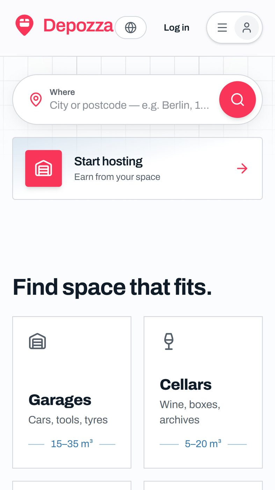
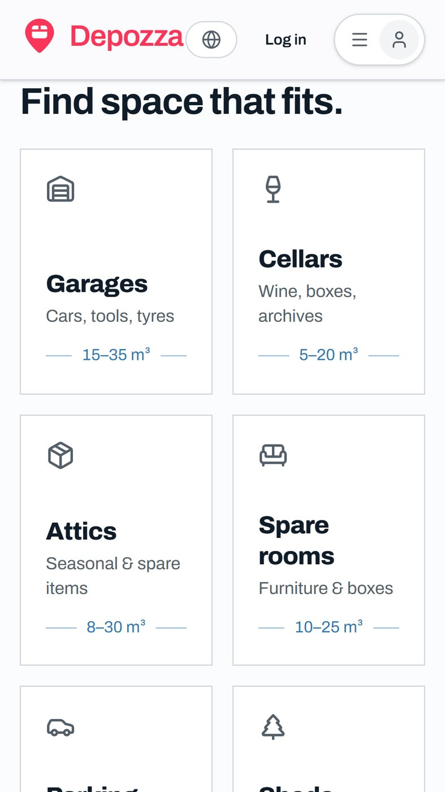
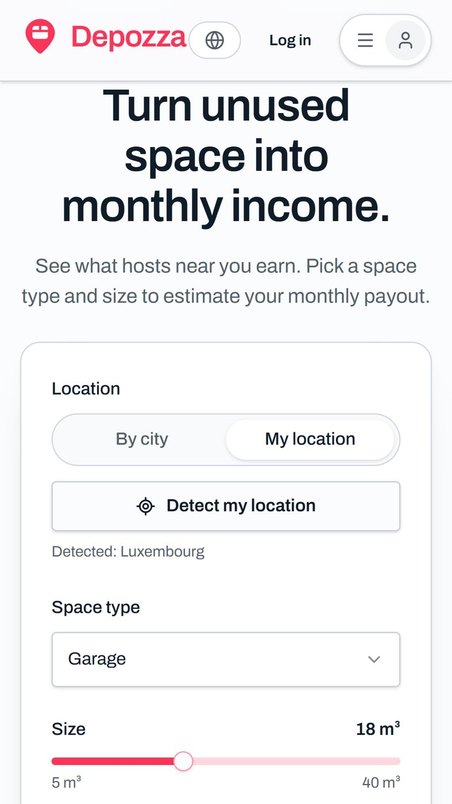

# Depozza

Storage space between neighbours. People with an empty garage, cellar, attic or spare room list it; people who need room nearby book it by the month.

**[depozza.com](https://depozza.com)** · Web, iOS and Android

## What it does

- Search by city or postcode for garages, cellars, attics and spare rooms
- Hosts list a space and get an estimate of what it could earn per month
- Booking, payment and chat happen inside the app

## Built with

TypeScript, React, TanStack Start, Supabase, Stripe, Capacitor.

The source code is private. This repository only holds the presentation.

---
A product of [Depozza SAS](https://depozza.com).
